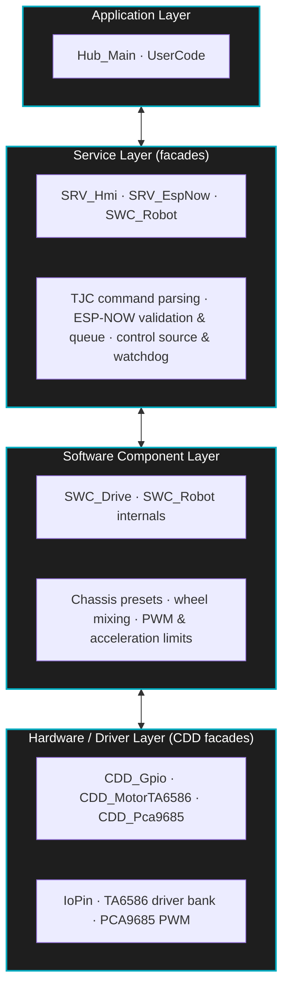

# Universal Robot Hub

A layered-architecture C++ firmware for a general-purpose robot (Universal Robot Hub), designed around the **SOLID** principles and an **AUTOSAR-lite** style.


[Features](#features) • [Architecture](#architecture) • [Hardware & PCB](#hardware--pcb-design) • [Quick Start](#quick-start) • [Documentation](#documentation)

---

## Features

- **Layered component architecture:** Reusable modules under `components/` (CDD drivers, SWC software components, SRV services), each with a public `api/` header and board config in `cfg/`.
- **C-style facade API:** Every component exposes `XXX_Begin()` / `XXX_Update()` entry points; `app/Hub_Main.cpp` wires the hub without touching component internals.
- **Six-motor chassis:** `SWC_Drive` provides six chassis presets with wheel mixing, PWM limit and acceleration limit; motors run through the TA6586 driver bank on a PCA9685.
- **Event-driven TJC HMI service:** Talks to TJC/Nextion displays over UART and supports invoking internal callbacks directly from the screen.
- **ESP-NOW remote link:** `SRV_EspNow` validates MAC, length, type and CRC, queues packets and delivers them to the robot from the main loop.
- **EEPROM storage & persistence:** Keeps settings, motor role assignments and drive mode across reboots.
- **Safety watchdog & failsafe:** Automatically cuts PWM and stops all motors when the control signal is lost for longer than the timeout.

---

## Architecture

The ESP32-S3 hub firmware is organized into application and reusable component layers. Each component publishes a small C-style facade in its `api/` folder; the composition root (`app/Hub_Main.cpp`) calls only these functions.



---

## Hardware & PCB Design

- **Hub MCU:** ESP32-S3 DevKitC-1 (Arduino framework, PlatformIO).
- **Motor driver:** TA6586 (six-motor bank on PCA9685 channel 0x40).
- **PWM controller:** PCA9685 (chip 1 at 0x40 for motors, chip 2 at 0x41 for servos).
- **HMI display:** TJC / Nextion (UART2).
- **Remote:** ESP-NOW (paired remote MAC in `components/SRV_EspNow/cfg/s3_devkit/EspNow_Cfg.h`).

> TODO: add schematic, PCB images and pinout table.

---

## Quick Start

### 1. Clone the repository

```bash
git clone https://github.com/YOUR_GITHUB_USERNAME/MegaESP_RobotControl.git
cd MegaESP_RobotControl
```

### 2. Build the firmware

Install PlatformIO Core or the PlatformIO IDE extension, then run from the repository root:

```powershell
pio run -e hub
```

To flash the hub and open its serial monitor:

```powershell
pio run -e hub -t upload
pio device monitor -e hub
```

Specify `-e hub` explicitly. The Mega 2560 and ESP8266 remote firmware is archived under `legacy/` and is separate from the ESP32-S3 hub build.

### 3. Build the documentation (EN / VI)

Requirements: Python, `sphinx`, `sphinx-intl`, `potranslator`; Doxygen (optional, used for the API page).

```bat
:: Full build and package the release into doc\release
tools\build.bat

:: Quick build, no release packaging
tools\build.bat local
```

Output:

| Mode | Path |
|---|---|
| Local | `doc/_build/html/en/index.html`, `doc/_build/html/vi/index.html` |
| Release | `doc/release/en/index.html`, `doc/release/vi/index.html` |

---

## Documentation

- [English](https://htmlpreview.github.io/?https://github.com/thanggtrann12/MegaESP_RobotControl/blob/main/doc/release/en/index.html)
- [Tiếng Việt (Vietnamese)](https://htmlpreview.github.io/?https://github.com/thanggtrann12/MegaESP_RobotControl/blob/main/doc/release/vi/index.html)


---

## License

MIT