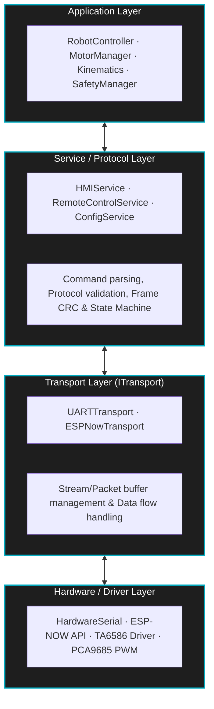

# Universal Robot Hub

A layered-architecture C++ firmware for a general-purpose robot (Universal Robot Hub), designed around the **SOLID** principles and an **AUTOSAR-lite** style.


[Features](#features) • [Architecture](#architecture) • [Hardware & PCB](#hardware--pcb-design) • [Quick Start](#quick-start) • [Documentation](#documentation)

---

## Features

- **Decoupled Kinematics Engine:** Supports multiple drive mechanisms (`DifferentialKinematics`, `MecanumKinematics`, `OmniKinematics`) through the purely mathematical `IKinematics` interface.
- **Dynamic Motor Binding (`MotorRole`):** Maps wheel roles (`FRONT_LEFT`, `REAR_RIGHT`, ...) to hardware slots independently of wiring order or bitmasks.
- **Event-Driven TJC HMI Service:** Talks to TJC/Nextion displays using ASCII encoding (32-127) and supports invoking internal callbacks directly from the screen.
- **Transport Abstraction (`ITransport`):** Separates the transport layer (`UARTTransport`, `ESPNowTransport`) from the command-handling layer (`HMIService`, `RemoteControlService`).
- **EEPROM Storage & Persistence:** Keeps settings, motor role assignments and drive mode across reboots.
- **Safety Watchdog & Failsafe:** Automatically cuts PWM and stops all motors when the control signal is lost for longer than the timeout.

---

## Architecture

The system is strictly layered to keep it extensible and maintainable (Separation of Concerns):



---

## Hardware & PCB Design

- **Supported MCUs:** Arduino Mega 2560, ESP32, ESP8266.
- **Motor driver:** TA6586.
- **PWM controller:** PCA9685.
- **HMI display:** TJC / Nextion (UART).

> TODO: add schematic, PCB images and pinout table.

---

## Quick Start

### 1. Clone the repository

```bash
git clone https://github.com/YOUR_GITHUB_USERNAME/MegaESP_RobotControl.git
cd MegaESP_RobotControl
```

### 2. Build the firmware

> TODO: add build/flash instructions (Arduino IDE or PlatformIO).

### 3. Build the documentation (EN / VI)

Requirements: Python, `sphinx`, `sphinx-intl`, `potranslator`; Doxygen (optional, used for the API page).

```bat
:: Full build and package the release into docs\release
build.bat

:: Quick build, no release packaging
build.bat local
```

Output:

| Mode | Path |
|---|---|
| Local | `docs/_build/html/en/index.html`, `docs/_build/html/vi/index.html` |
| Release | `docs/release/en/index.html`, `docs/release/vi/index.html` |

---

## Documentation

- [English](https://htmlpreview.github.io/?https://github.com/thanggtrann12/MegaESP_RobotControl/blob/main/docs/release/en/index.html)
- [Tiếng Việt (Vietnamese)](https://htmlpreview.github.io/?https://github.com/thanggtrann12/MegaESP_RobotControl/blob/main/docs/release/vi/index.html)


---

## License

MIT