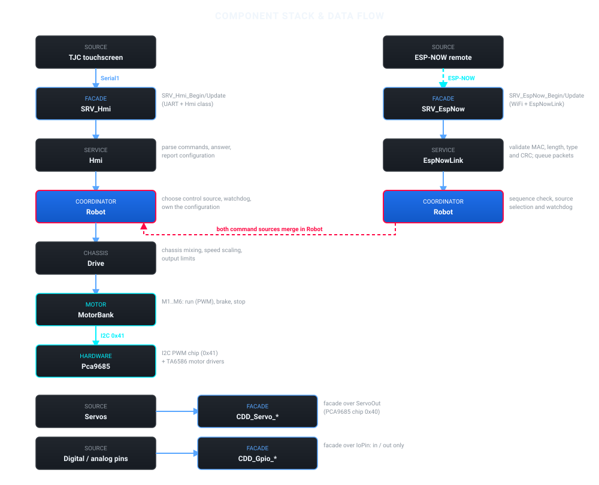
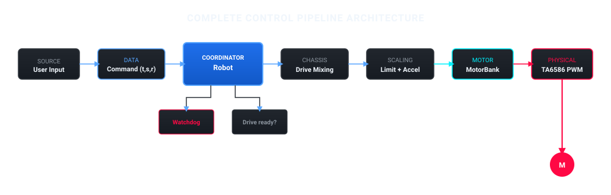
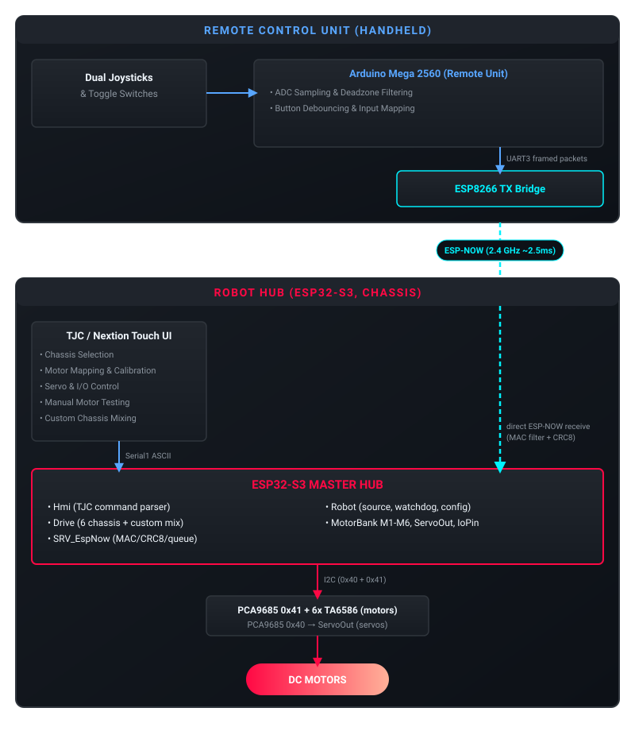

System Architecture & Design Philosophy
=======================================

System Overview
---------------
The firmware turns an ESP32-S3 into a *plug, configure, play* robot controller. One firmware drives many chassis types; the TJC touchscreen chooses the chassis, maps motors to wheels, calibrates directions and saves the result to EEPROM. No rebuild is needed to change the robot.

The ESP32-S3:

* Drives two-wheel, tank, 4-wheel omni, mecanum, 6-wheel and custom chassis
* Runs six DC motors (M1 to M6) and up to sixteen servos through PCA9685 chips
* Exposes digital and analog pins as plain inputs or outputs
* Takes commands from the TJC touchscreen over UART and from the ESP-NOW remote directly
* Stops all motors when the command link is lost
* Stores the robot configuration in EEPROM

Layers
------

Each layer only knows the layer directly below it. The motor layer does not know what a wheel is, and ``Drive`` does not know which chip moves a motor.

Facade API
----------

The app layer never touches the classes above directly. Every component publishes a small C-style facade in its ``api/`` folder:

* ``XXX_Begin()`` creates the (lazy, file-local) instance and starts the hardware.
* ``XXX_Update()`` runs one service tick from ``loop()``.
* Feature calls such as ``CDD_Motor_Run()`` or ``SWC_Robot_OnRemote()`` forward to the same instance.

``app/Hub_Main.cpp`` calls only these functions, so the composition root stays free of component internals and every module is wired the same way.

Where the code lives
--------------------

.. list-table::
   :widths: 25 45 30
   :header-rows: 1

   * - Folder
     - Responsibility
     - Facade entry points
   * - ``components/CDD_Pca9685``
     - I2C PWM chip: channel duty cycle and servo outputs.
     - ``CDD_Servo_Begin()``, ``CDD_Servo_Write()``, ``CDD_Servo_Release()``
   * - ``components/CDD_MotorTA6586``
     - Motor interface, TA6586 driver and six-motor bank.
     - ``CDD_Motor_Begin()``, ``CDD_Motor_Run()``, ``CDD_Motor_StopAll()``
   * - ``components/CDD_Gpio``
     - Configure a pin as input or output, read and write it.
     - ``CDD_Gpio_Begin()``, ``CDD_Gpio_ReadPin()``, ``CDD_Gpio_WritePin()``
   * - ``components/SWC_Drive``
     - The six chassis presets, wheel mixing, PWM limit and acceleration limit.
     - used through ``SWC_Robot``
   * - ``components/SWC_Robot``
     - Robot control, configuration validation and EEPROM load and save.
     - ``SWC_Robot_Begin()``, ``SWC_Robot_Update()``, ``SWC_Robot_OnRemote()``
   * - ``components/SRV_Hmi``
     - TJC command protocol and handlers.
     - ``SRV_Hmi_Begin()``, ``SRV_Hmi_Update()``
   * - ``components/SRV_EspNow``
     - ESP-NOW receive validation and packet queue.
     - ``SRV_EspNow_Begin()``, ``SRV_EspNow_Update()``
   * - ``app/Hub_Main.cpp``
     - Composition root and ``setup()`` / ``loop()`` for the ESP32-S3 hub.
     - calls only the facades above

Control Pipeline
----------------

System Architecture & Wireless Data Flow
----------------------------------------

Design Philosophy
-----------------

1. **Simple:**
    A newcomer should be able to read ``app/Hub_Main.cpp`` and follow the whole system in a few minutes.

2. **Layered:**
   Motors only run, brake or stop. Servos only move to an angle. Pins are only inputs or outputs. Everything else is built on top.

3. **Configurable:**
   The touchscreen decides the chassis, the motor mapping and the limits. These are data in EEPROM, not code.

4. **Safe by default:**
   If the chassis is not fully mapped, or the command link is silent, the motors stay stopped.
